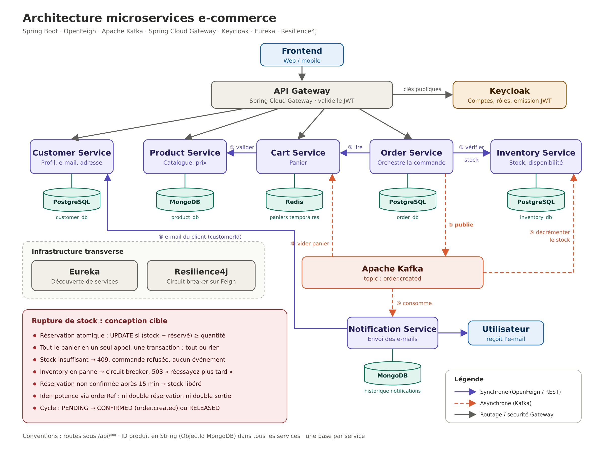

# E-commerce Platform

[](https://github.com/Zepe237/ecommerce-microservices/actions/workflows/ci.yml)

Backend e-commerce découpé en six microservices Spring Boot. Les services échangent de façon synchrone par HTTP (OpenFeign) quand une réponse immédiate est nécessaire, et de façon asynchrone par Apache Kafka pour tout ce qui peut se faire après la validation d'une commande.

Le projet sert de terrain d'application aux problématiques concrètes d'une architecture distribuée : une base de données par service, la cohérence entre services, l'idempotence des consommateurs Kafka et la gestion des pannes d'un service dépendant.



## Sommaire

- [Services](#services)
- [Passage d'une commande](#passage-dune-commande)
- [Stack technique](#stack-technique)
- [Démarrage local](#démarrage-local)
- [Scénario de test](#scénario-de-test)
- [Identité et accès](#identité-et-accès)
- [Dépannage](#dépannage)
- [Conventions](#conventions)
- [Tests](#tests)
- [Structure du dépôt](#structure-du-dépôt)
- [Limites connues et feuille de route](#limites-connues-et-feuille-de-route)

## Services

| Service | Port | Responsabilité | Stockage |
|---|---|---|---|
| `api-gateway` | 8080 | Point d'entrée unique : validation des tokens, contrôle d'accès, routage | aucun |
| `order-service` | 8081 | Orchestre la commande : panier, vérification du stock, persistance, publication de l'événement | PostgreSQL |
| `cart-service` | 8082 | Panier du client, avec copie du nom et du prix au moment de l'ajout | Redis |
| `product-service` | 8083 | Catalogue produits | MongoDB |
| `inventory-service` | 8084 | Niveaux de stock et contrôle de disponibilité | PostgreSQL |
| `customer-service` | 8085 | Profils clients | PostgreSQL |
| `notification-service` | 8086 | Courriels de confirmation et historique des envois | MongoDB |

Chaque service possède sa propre base et n'accède jamais à celle d'un autre. Les références entre services (`customerId`, `productId`) sont de simples identifiants, sans clé étrangère.

### Communications

| Appelant | Appelé | Mode | Usage |
|---|---|---|---|
| cart-service | product-service | HTTP (Feign) | Valider le produit, récupérer nom et prix |
| order-service | cart-service | HTTP (Feign) | Lire le panier au moment de la commande |
| order-service | inventory-service | HTTP (Feign) | Vérifier la disponibilité de tout le panier en un appel |
| notification-service | customer-service | HTTP (Feign) | Résoudre l'adresse e-mail du client |
| order-service | topic `order.created` | Kafka | Annoncer une commande confirmée |
| inventory-service | topic `order.created` | Kafka | Décrémenter le stock |
| cart-service | topic `order.created` | Kafka | Vider le panier |
| notification-service | topic `order.created` | Kafka | Envoyer le courriel de confirmation |

## Passage d'une commande

1. Le client appelle `POST /api/orders` sur l'order-service.
2. L'order-service récupère le panier auprès du cart-service. Un panier vide est refusé (422).
3. Il envoie l'ensemble des lignes à l'inventory-service, qui répond en une fois avec la liste des produits indisponibles. Si la liste n'est pas vide, la commande est refusée (409) : rien n'est enregistré, aucun événement n'est publié.
4. La commande est enregistrée avec le statut `CONFIRMED`. Le nom et le prix de chaque produit sont figés dans les lignes de commande.
5. L'événement `order.created` est publié, avec l'identifiant de commande comme clé de message.
6. Les trois consommateurs réagissent indépendamment : l'inventory-service décrémente le stock, le cart-service vide le panier, le notification-service envoie le courriel.

L'order-service ne connaît pas ses consommateurs. Ajouter un nouveau traitement (facturation, statistiques) revient à abonner un nouveau service au topic, sans modifier l'order-service.

## Stack technique

- Java 21, Spring Boot 4.1, Spring Cloud 2025.1 (Gateway Server MVC, OpenFeign)
- Spring Security (OAuth2 Resource Server)
- Spring Data JPA (Hibernate 7), Spring Data MongoDB, Spring Data Redis
- Apache Kafka 4 (mode KRaft) avec Spring Kafka
- PostgreSQL 17, MongoDB 7, Redis 7
- Keycloak 26 (OAuth2, OpenID Connect)
- Mailpit pour capturer les courriels en développement
- springdoc-openapi pour la documentation des API
- JUnit 5, Mockito, AssertJ, Testcontainers, REST Assured
- Maven multi-module, Docker Compose

## Démarrage local

### Prérequis

- JDK 21
- Docker Desktop (ou Docker Engine avec le plugin Compose)
- Aucune installation de Maven n'est nécessaire : le wrapper `mvnw` est fourni.

### 1. Démarrer l'infrastructure

```bash
docker compose up -d
docker compose ps
```

Le fichier `docker-compose.yml` démarre trois instances PostgreSQL, deux MongoDB, Redis, Kafka, Mailpit, ainsi que Keycloak et sa base dédiée. Les identifiants par défaut (`root` / `password`) peuvent être surchargés dans un fichier `.env` créé à partir de `.env.example`.

| Conteneur | Port hôte |
|---|---|
| PostgreSQL order / inventory / customer | 5433 / 5434 / 5435 |
| MongoDB product / notification | 27017 / 27018 |
| Redis | 6379 |
| Kafka | 9092 |
| Mailpit (SMTP / interface web) | 1025 / 8025 |
| Keycloak (console d'administration) | 8180 |

### 2. Compiler

```bash
./mvnw clean install -DskipTests
```

### 3. Lancer les services

Depuis l'IDE (une configuration d'exécution par classe `*Application`), ou en ligne de commande, un terminal par service :

```bash
./mvnw -pl api-gateway spring-boot:run
./mvnw -pl product-service spring-boot:run
./mvnw -pl inventory-service spring-boot:run
./mvnw -pl customer-service spring-boot:run
./mvnw -pl cart-service spring-boot:run
./mvnw -pl order-service spring-boot:run
./mvnw -pl notification-service spring-boot:run
```

Le profil `dev` est actif par défaut. Il alimente le catalogue avec cinq produits (`PRD-0001` à `PRD-0005`) et l'inventaire avec les stocks correspondants. Pour le désactiver : `SPRING_PROFILES_ACTIVE=prod`.

Toute la configuration réseau passe par des variables d'environnement avec une valeur par défaut adaptée au poste local (`DB_HOST`, `KAFKA_BOOTSTRAP_SERVERS`, `PRODUCT_SERVICE_URL`, etc.), ce qui permettra de conteneuriser les services sans modifier le code.

### Documentation des API

Chaque service expose sa documentation OpenAPI sur `http://localhost:<port>/swagger-ui.html`, par exemple http://localhost:8081/swagger-ui.html pour l'order-service.

Swagger UI appelle le service directement, sur son propre port : ces requêtes ne passent pas par l'API Gateway et ne sont donc soumises à aucun contrôle d'accès. Swagger sert à explorer et tester le fonctionnel d'un service ; les règles de sécurité se testent en appelant la Gateway (voir [API Gateway](#api-gateway)).

## Scénario de test

Le fichier [`docs/api-requests.http`](docs/api-requests.http) contient le parcours complet, exécutable directement depuis IntelliJ IDEA. En résumé, avec `curl` :

```bash
# Créer un client
curl -X POST localhost:8085/api/customers -H "Content-Type: application/json" \
     -d '{"name": "Jane Doe", "email": "jane.doe@example.com"}'

# Ajouter deux produits au panier du client 1
curl -X POST localhost:8082/api/carts/1/items -H "Content-Type: application/json" \
     -d '{"productId": "PRD-0001", "quantity": 2}'
curl -X POST localhost:8082/api/carts/1/items -H "Content-Type: application/json" \
     -d '{"productId": "PRD-0004", "quantity": 1}'

# Passer la commande
curl -X POST localhost:8081/api/orders -H "Content-Type: application/json" \
     -d '{"customerId": 1}'
```

Après la commande : le panier est vide (`GET /api/carts/1`), le stock de `PRD-0001` est passé de 25 à 23 (`GET /api/inventory/PRD-0001`), et le courriel de confirmation est visible dans Mailpit sur http://localhost:8025.

## Identité et accès

Keycloak est le fournisseur d'identité de la plateforme (OAuth2 / OpenID Connect). Il authentifie les utilisateurs et émet des access tokens JWT signés ; les services ne stockent aucun mot de passe et se contentent de valider ces tokens avec la clé publique de Keycloak.

Au démarrage, Keycloak importe le realm `ecommerce` décrit dans [`keycloak/realm-ecommerce.json`](keycloak/realm-ecommerce.json) :

| Élément | Valeur |
|---|---|
| Realm | `ecommerce` |
| Rôles | `CUSTOMER` (attribué par défaut à tout nouvel utilisateur), `ADMIN` |
| Client `ecommerce-frontend` | application web, flux *Authorization Code* avec PKCE |
| Client `ecommerce-dev-cli` | tests locaux uniquement, autorise le *password grant* |
| Utilisateurs de test | `jane.doe@example.com` (CUSTOMER), `admin@example.com` (ADMIN), mot de passe `password` |

Obtenir un token en local :

```bash
curl -s -X POST http://localhost:8180/realms/ecommerce/protocol/openid-connect/token \
     -d grant_type=password -d client_id=ecommerce-dev-cli \
     -d username=jane.doe@example.com -d password=password
```

L'émetteur des tokens est fixé à `http://localhost:8180/realms/ecommerce`. Un token est valable cinq minutes.

L'import n'a lieu qu'à la création du realm : si le realm `ecommerce` existe déjà dans la base de Keycloak, le fichier est ignoré. Pour repartir du fichier, supprimer le volume de Keycloak (`docker compose down` puis `docker volume rm ecommerce_pgdata-keycloak`).

### API Gateway

Les clients n'appellent que l'API Gateway (Spring Cloud Gateway, port 8080). Elle joue le rôle de *resource server* : elle vérifie la signature, l'expiration et l'émetteur de chaque token avec les clés publiques de Keycloak, applique les règles d'accès, puis transmet la requête au service concerné en conservant l'en-tête `Authorization`.

| Requête | Accès |
|---|---|
| `GET /api/products/**` | public |
| `POST`/`PUT`/`DELETE /api/products/**`, `PUT /api/inventory/**`, `GET /api/customers` | rôle `ADMIN` |
| `/api/inventory/availability` | refusé : appel interne entre services uniquement |
| `/error` | public, pour que le client reçoive le vrai statut d'erreur (502, 503...) et non un 401 |
| toute autre route | utilisateur authentifié |

Les rôles Keycloak (claim `realm_access.roles`) sont convertis en autorités Spring Security `ROLE_*` par `KeycloakRealmRoleConverter`.

Résultats attendus, vérifiés de bout en bout :

| Requête | Identité | Statut |
|---|---|---|
| `GET /api/products` | aucune | 200 |
| `GET /api/carts/1` | aucune | 401 |
| `GET /api/carts/1` | Jane (CUSTOMER) | 200 |
| `GET /api/customers` | Jane (CUSTOMER) | 403 |
| `GET /api/customers` | admin (ADMIN) | 200 |
| `POST /api/products` | Jane (CUSTOMER) | 403 |
| `POST /api/inventory/availability` | admin (ADMIN) | 403 |
| `GET /api/carts/1` | token à la signature modifiée | 401 |

```bash
TOKEN=$(curl -s -X POST http://localhost:8180/realms/ecommerce/protocol/openid-connect/token \
        -d grant_type=password -d client_id=ecommerce-dev-cli \
        -d username=jane.doe@example.com -d password=password | jq -r .access_token)

curl localhost:8080/api/products                                   # 200, public
curl localhost:8080/api/carts/1                                    # 401, pas de token
curl localhost:8080/api/carts/1 -H "Authorization: Bearer $TOKEN"  # 200
curl localhost:8080/api/customers -H "Authorization: Bearer $TOKEN" # 403, réservé à ADMIN
```

## Dépannage

| Symptôme | Cause probable | Solution |
|---|---|---|
| La Gateway ne démarre pas : port 8080 déjà utilisé | Un autre programme écoute sur 8080 (sous Windows, souvent Apache `httpd.exe`) | `netstat -ano \| findstr :8080` pour trouver le processus, l'arrêter, ou lancer la Gateway avec `SERVER_PORT=8090` |
| `spring-boot:run` à la racine : *Unable to find a suitable main class* | La commande est lancée sur le POM parent | Cibler un module : `./mvnw -pl api-gateway spring-boot:run` |
| La Gateway répond 500 sur une route | Le service de destination n'est pas démarré | Démarrer le service concerné (voir le tableau des ports) |
| Keycloak refuse le token : *Account is not fully set up* | L'utilisateur a une action requise, par exemple un mot de passe créé avec l'option *Temporary* | Dans la console Keycloak, fiche de l'utilisateur, vider *Required user actions* ; décocher *Temporary* lors de la saisie d'un mot de passe |
| Keycloak refuse le token : *Invalid user credentials* | Utilisateur absent ou mot de passe différent | Vérifier l'utilisateur dans le realm `ecommerce` ; le fichier du realm n'est réimporté que sur une base vide |
| Conflit de port au `docker compose up` | Des conteneurs d'un ancien projet occupent les mêmes ports | `docker ps` puis arrêter les conteneurs concernés |

## Conventions

**Routes.** Toutes les API sont exposées sous `/api/**`, au pluriel (`/api/orders`, `/api/carts`). Ce préfixe commun simplifiera le routage par l'API Gateway.

**Erreurs.** Les erreurs suivent le format standard *Problem Details* (RFC 9457) :

```json
{
  "type": "about:blank",
  "title": "Conflict",
  "status": 409,
  "detail": "Insufficient stock for products [PRD-0003]",
  "instance": "/api/orders",
  "unavailableProductIds": ["PRD-0003"]
}
```

| Situation | Statut |
|---|---|
| Données invalides | 400 |
| Ressource introuvable | 404 |
| Stock insuffisant, e-mail déjà utilisé | 409 |
| Panier vide au moment de la commande | 422 |
| Service dépendant indisponible | 503 |

**Identifiants.** Les produits sont identifiés par une chaîne (identifiant MongoDB), partout où ils apparaissent. Les clients et les commandes ont un identifiant numérique généré par PostgreSQL.

**Contrats entre services.** Aucun service n'importe les classes d'un autre. Chaque client Feign et chaque consommateur Kafka déclare sa propre copie du contrat, limitée aux champs qu'il utilise. Les champs inconnus sont ignorés à la désérialisation, ce qui permet de faire évoluer un producteur sans casser ses consommateurs.

**Consommateurs Kafka.** Chaque consommateur est idempotent : l'inventory-service mémorise les commandes déjà traitées, le notification-service s'appuie sur un index unique par commande. En cas d'échec, un message est retenté trois fois à cinq secondes d'intervalle avant d'être abandonné et journalisé.

**Organisation du code.** Chaque service suit la même structure de packages :

```
com.feusap.ecommerce.<service>
├── client        clients Feign et leurs DTO
├── config        configuration Spring
├── controller    endpoints REST
├── domain        entités et documents persistés
├── dto           contrats d'entrée et de sortie des API
├── exception     exceptions métier et traduction en réponses HTTP
├── mapper        conversions entre domaine et DTO
├── messaging     événements, producteurs et consommateurs Kafka
├── repository    accès aux données
└── service       logique métier
```

Les entités ne sont jamais exposées directement par les contrôleurs. Elles protègent leurs invariants : pas de setters publics, modifications par des méthodes métier (`Order.confirm()`, `Cart.addItem()`, `InventoryItem.updateQuantity()`).

## Tests

```bash
./mvnw verify
```

| Niveau | Outils | Exemple |
|---|---|---|
| Unitaire | JUnit 5, Mockito, AssertJ | `OrderServiceTest`, `InventoryServiceTest`, `CartServiceTest` |
| Couche web | `@WebMvcTest`, MockMvc | `ProductControllerTest` |
| Intégration | `@SpringBootTest`, Testcontainers, REST Assured | `ProductApiIntegrationTest` |

Les tests d'intégration démarrent de vraies instances PostgreSQL, MongoDB, Redis et Kafka avec Testcontainers : Docker doit être lancé.

## Structure du dépôt

```
.
├── pom.xml                   POM parent : versions, BOM Spring Cloud, plugins communs
├── docker-compose.yml        infrastructure locale
├── keycloak/
│   └── realm-ecommerce.json  realm importé au démarrage de Keycloak
├── docs/
│   ├── architecture.png
│   └── api-requests.http     scénario de bout en bout
├── api-gateway/
├── product-service/
├── inventory-service/
├── cart-service/
├── order-service/
├── customer-service/
└── notification-service/
```

## Limites connues et feuille de route

Le périmètre actuel couvre le parcours de commande de bout en bout. Les points suivants sont identifiés et planifiés :

- **Sécurité.** Keycloak et l'API Gateway sont en place. Restent la validation des tokens dans chaque service (défense en profondeur), la lecture de l'identité du client dans le token au lieu du `customerId` transmis dans la requête, et la fermeture des ports des services en dehors du réseau interne.
- **Réservation du stock.** La vérification actuelle laisse une fenêtre entre le contrôle de disponibilité et la décrémentation. La cible est une réservation atomique au moment de la commande, confirmée par `order.created` et libérée automatiquement si elle n'est pas confirmée.
- **Fiabilité de la publication.** Si Kafka est indisponible juste après l'enregistrement d'une commande, l'événement est perdu. Le pattern *Transactional Outbox* garantira sa publication.
- **Résilience.** Circuit breaker Resilience4j sur les appels Feign, et topic d'erreurs (*dead letter topic*) pour les messages Kafka en échec.
- **Découverte de services.** Eureka, pour remplacer les URL configurées.
- **Migrations de schéma.** Flyway à la place de `ddl-auto=update`.
- **Synchronisation catalogue et inventaire.** Un événement `product.created` pour créer automatiquement la ligne de stock d'un nouveau produit.
- **Observabilité.** Actuator, traces distribuées et métriques.

## Auteur

Vadel Tsague — [LinkedIn](https://www.linkedin.com/in/vadel-tsague) · [GitHub](https://github.com/Zepe237)
